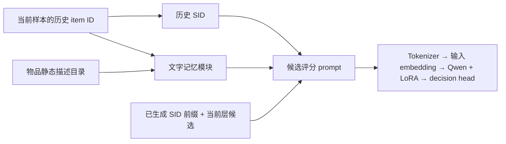

# 用户历史文字记忆

当前默认流程在每次 OpenJev 候选评分时，同时输入历史 SID 和这些历史物品的文字描述，让 Qwen 文本骨干可以利用物品的语义内容。该模块按样本当前允许的历史 item ID 检索描述，不增加神经网络参数。

## 数据流与 prompt



新增 `state.history_text_memory`，按与历史 SID 相同的顺序，从旧到新列出物品。示意：

```text
Previously interacted items, oldest to newest; same order as history SIDs:
1. Toy Story (1995). Genres: Animation, Children's, Comedy.
2. Jumanji (1995). Genres: Adventure, Children's, Fantasy.
```

标题和类型来自现有 `data/ml1m_qwen_sequences/item_semantic_ids.jsonl` 中的 `text` 字段；缺少 `text` 时可由 `title` 和 `genres` 构造。ML-1M 当前数据不提供剧情简介。所有候选共用相同历史记忆，候选仍是当前层的 SID。

记忆窗口与已有 SID 窗口一致：当前为最近 **20 个**历史物品。模块保留窗口内每个物品的完整描述，不作摘要、不丢弃旧条目、不静默截断。当前 checkpoint 上限为 4096 token；以目录中描述 token 数最长的 20 个物品进行压力检查，得到 924 token。更换长描述数据后，如超出模型上限会明确报错，需调整数据的 `max_history`。

## 一致性与历史边界

- 通过真实 item ID 检索，逐项核对历史 SID；同 SID 的不同物品仍使用各自描述。
- SFT、校准与验证使用 `SequenceData` 已切分的历史；不读取当前目标或其后续交互的描述。若某物品曾在更早历史中出现，其历史描述仍合法。
- GSPO 在采样组中保留相同的历史 item ID，采样、旧策略复用、正样本 NLL 和梯度重算使用同一份记忆。
- 推荐使用调用方传入的历史，在同一窗口内取 SID 与文本；当前目标前缀只由模型已生成的 SID 构成。
- 原词表和 Qwen 基础权重冻结，仍仅训练 LoRA、decision head、SID embedding；文字通过原 tokenizer/embedding 输入，再由可训练 LoRA 参与理解。

## 运行与兼容

正式对比使用 [OpenJev 单卡运行步骤](../../comparison/OPENJEV_MINIONEREC.md)。从相同初始 checkpoint 做记忆消融时，把其中 SFT 的 `--history-memory on` 改为 `--history-memory off`，并指定新的输出目录。分阶段运行的命令见 [分层 SID 运行步骤](SID_TOKENS.md#运行)。

单独训练可传 `--history-memory auto|on|off`：分层 SID 的 SFT 在 `auto` 下启用记忆；GSPO 的 `auto` 恢复来源 checkpoint 的配置。给旧模型新增文字记忆应先进行 SFT；直接给无记忆 checkpoint 的 GSPO 指定 `on` 会报错。

推理自动读取 checkpoint 的记忆配置。下面以分阶段命令生成的 checkpoint 为例。

```bash
HF_HUB_OFFLINE=1 python -B -u -m pipeline.train_infer.recommend --data data/ml1m_qwen_sequences \
  --checkpoint runs/sid-gspo/checkpoint \
  --base-model models/qwen3.5-2b --beam-size 4 --top-k 4 --test-users 10 \
  --output runs/sid-memory-evaluation.json
```

checkpoint 新增 `history_memory.json`，只保存静态物品描述及 SID 映射，不保存用户历史。`model.json` 记录格式版本、物品数和 SHA-256。加载时检查完整性；训练或推荐指定的数据目录若修改了描述/映射，会拒绝混用。迁移 checkpoint 时需一并复制该文件。

旧 checkpoint 在推理时继续使用原输入格式。已训练的记忆 checkpoint 不允许静默关闭记忆；消融实验应从相同无记忆初始 checkpoint 分别训练。每次记忆训练会输出 `prompt_example.txt`，可直接检查模型看到的完整 prompt。

## 代码位置

| 文件 | 职责 |
|---|---|
| `pipeline/models/history_memory.py` | 描述目录、历史检索与校验、checkpoint 保存恢复 |
| `pipeline/models/sid_tokens.py` | 统一 `prepare_record`：添加文字记忆后转换分层 SID |
| `pipeline/train_infer/gspo.py` | 在 rollout 与重算之间传递相同历史 item ID |
| `pipeline/train_infer/recommend.py` | 推荐历史窗口与记忆对齐，恢复并校验 checkpoint 描述目录 |
| `pipeline/train_infer/train_lora.py` | 默认启用、兼容性检查、实际 prompt 示例和实验记录 |

## 历史运行结果

在 WSL Anaconda 的 `openjev_sid`、RTX 4080 上已完成 1 步 SFT 与 2 步 GSPO；两阶段重载 logits 最大误差均为 **0**，LoRA/head/SID embedding 均有更新。两阶段记忆目录的 SHA-256 相同。实际保存的 20 条历史 prompt 示例为 634 token，见 `runs/history-memory-smoke/stage1/prompt_example.txt`。

| 实测指标 | SFT | GSPO |
|---|---:|---:|
| 优化步数 | 1 | 2 |
| 末步损失 | 5.636810 | 0.690431 |
| SID embedding 最大参数变化 | 0.000100091 | 0.000200234 |
| 重载最大误差 | 0 | 0 |
| PyTorch 峰值已分配显存 | 4.123 GiB | 4.123 GiB |

GSPO 首次更新策略 logit 梯度范数为 0.22052；第二次复用旧策略轨迹时全部触发裁剪，正样本 NLL 继续提供梯度。每阶段仅用 3 条校准记录，拟合温度均落在搜索上限 20；该短程设置不构成可靠的概率校准或效果评估。

本次是功能验收，推荐效果需要后续正式训练与完整评估。checkpoint 和验收结果保存在 `runs/history-memory-smoke`。

beam=4、top-k=4 的单用户推荐验收通过，4 个结果均为有效且未交互的目录物品。该用户 Recall@4/NDCG@4 均为 0，不代表全量评估结果。机器可读验收记录见 `runs/history-memory-smoke/verification.json`。
